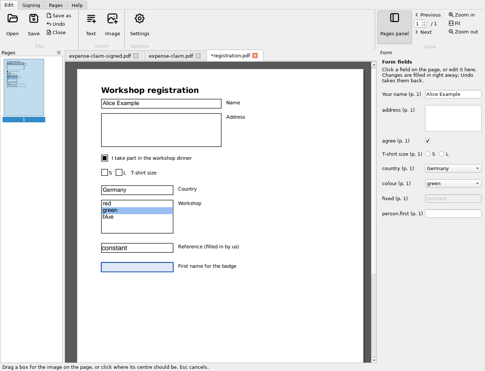

# GUI guide

```bash
slim-pdf gui [file.pdf ...]     # or: slim-pdf-gui [file.pdf ...]
```

The GUI uses the same certificate profiles as the CLI (see [cli.md](cli.md)).
The screenshots are generated by `scripts/make_screenshots.py`.

## Language

The GUI is available in English and German. It follows the system language
unless you pick one under **Settings…** (it applies after a restart); the
environment variable `SLIM_PDF_LANG` overrides both. Screenshots in this
guide show the English version.

## Main window


* **Ribbon** (top), in four tabs:
  * *Edit* (the first tab, shown when a document is opened): **Open…**
    (`Ctrl+O`), **Save**, **Save as…**, **Undo**, **Close** (`Ctrl+W`);
    **Text…** and **Image…** (see
    [Adding text and images](#adding-text-and-images)); **Settings…** (also
    for the certificates). The form is in the side panel (see
    [Filling in forms](#filling-in-forms)).
  * *Signing:* **Place signature… / Sign…** (`Ctrl+S`) and **Remove
    signature box** (`Esc`); the signature's settings: **Sign with** (the
    certificate), **Stamp shows** *Image* and/or *Text*; the document's
    signatures: **Check again** (validate anew, e.g. after changing the
    trusted certificates) and **Details…** (the report of the signature
    chosen in the *Signatures* list).
  * *Pages:* rotate, crop and delete pages; copy, cut and paste them (see
    [Page tools](#page-tools)).
  * *Help:* **Documentation** (`F1`, this guide online), **About Slim PDF**
    (version, and the libraries it is built on).
  * *View*, a group at the ribbon's right end, the same on every tab:
    **Pages panel** (show or hide the thumbnails); **Previous**, the page
    number, **Next** (`PgUp`/`PgDown`, or type the number); **Zoom in**,
    **Fit** (fit width), **Zoom out** (`Ctrl +`/`Ctrl -`).

  **Open…** starts in the folder of the last file you opened, also after
  a restart (remembered in `gui.json` in the user state folder, e.g.
  `~/.local/state/slim-pdf/` on Linux).

* **Documents:** every PDF you open gets a tab of its own (the tab bar
  appears with the second one). **Open…** takes several files at once
  (`Ctrl`/`Shift`-click them), and PDFs dragged onto the window from a file
  manager open as well; `Ctrl+Tab` / `Ctrl+Shift+Tab` switch
  between them. Each keeps its page, zoom, unsaved edits and Undo; the
  ribbon and the panels act on the current one. Opening a file that is
  already open shows its tab (and reads it again, unless it has unsaved
  edits). **Close** or the tab's ×  closes a document, asking first if it
  has unsaved edits; so does closing the window, for each of them.
  `slim-pdf gui a.pdf b.pdf` opens both.
* **Page:** the mouse wheel zooms in and out around the mouse pointer (out
  only until the whole page fits the view);
  press and hold the left mouse button and move to move the page. Prepared
  signature fields appear as boxes:
  * blue, dashed: empty, can be signed; a click signs it;
  * green: already signed; a click shows the signature's details;
  * red: locked by an earlier signature.

  Form fields show a dotted frame under the mouse; a click fills them in
  (see [Filling in forms](#filling-in-forms)).
* **Pages panel** (left): thumbnails. Click one to go there; Ctrl- or
  Shift-click to select several pages for the page tools; drag pages to
  reorder them.
* **Side panel** (right): the tools of the ribbon tab in use.
  * *Edit* tab: the **Form** panel (see [Filling in forms](#filling-in-forms)).
  * *Signing* tab: the **Sign** panel with the current target, the **Place
    signature…** / **Sign…** button, and lists of the signature fields and
    of the signatures.
  * Other tabs: no side panel, so the page gets the room.

  Signing (`Ctrl+S`, or a click on a signature field) switches to
  *Signing*, and it stays there after signing for further signatures; a
  click on a form field switches to *Edit*.

## Placing a new signature


1. Pick a certificate under *Sign with* in the ribbon (*Signing* tab).
2. Press **Place signature…** (`Ctrl+S`), then **click** where the signature
   should go. A preview of the signature image appears centred on the click,
   and the page is back to zooming and moving. `Esc` cancels instead.
3. **Drag** the preview to move it. It always stays inside the page.
4. **Resize** it by dragging the blue corner handle or with `Ctrl` + mouse
   wheel over it. The aspect ratio of the signature image is kept.
5. The panel shows the exact position and size in PDF points, and the button
   now reads **Sign…**.

`Esc` (or *Remove signature box*) removes the preview. A placement stays on its
page while you browse other pages.

## Signing a prepared field


Click an empty field on the page: it turns solid blue and becomes the
target. With several certificates configured, slim-pdf asks which one to
sign with (the one selected in the ribbon is preselected; with only one,
that is used without asking), then signing starts (see
[Signing](#signing)). Cancelling the question keeps the field selected.
To change the appearance options first, pick the field in the list on the
right instead (or press **Place signature…** and click the field); then
press **Sign…**. The stamp is fitted into the field's rectangle.

## Signing

Press **Sign…** (`Ctrl+S`) and choose where to save; the default is
`<name>-signed.pdf` (for a file already named `…-signed.pdf`, the same name,
so the file dialog asks before replacing it). Depending on the profile, slim-pdf asks for the
passphrase, the token PIN or the KeePass master password:


After signing, the signed file is reopened. You can add more signatures right
away, for example with another certificate:


In this example only Alice's certificate is in the trust list, so the
*Signatures* list shows her signature as valid and the supervisor's as
untrusted (see [Checking signatures](#checking-signatures)).

If the target field is locked by an earlier signature, slim-pdf warns you
that signing will invalidate that signature, and you can still go ahead. The
same warning appears when you place a new signature box on a certified
document: that breaks the certification, while signing one of its empty
fields doesn't.
Documents certified as "no changes allowed" can't be signed again; the status
bar points this out when you open one.

*Stamp shows: Image / Text* in the ribbon switch the stamp to image only or
text only for the next signature.

## Checking signatures

The *Signatures* list on the right validates every signature when a document
is opened:

* green: **valid**;
* orange: **untrusted**, i.e. intact but the certificate doesn't chain to a
  trusted root (e.g. self-signed). Intermediate certificates a signature
  lacks are downloaded once and cached (see
  [cli.md](cli.md#check-signatures-slim-pdf-verify));
* red: **invalid**, i.e. the content was modified or changed in a way the
  signature doesn't allow;
* grey: **not checked**, a signature in a legacy format slim-pdf can't
  validate (e.g. `adbe.x509.rsa_sha1`); signer and time are still shown.

A signature followed by allowed changes, such as filled-in form fields or
further signatures, gets a third line *then changed (allowed)*: what you
see now is not exactly what was signed. The tooltip says which changes.

Click a signature to jump to its page. Double-click it (or click the signed
field on the page) for its details: the verdict, time, what it covers and
any problems, then the signer's certificate in the same form as
*Settings…* → *Certificates* → *Details…* shows your own, and pyHanko's full report behind *Full report…*.
The tooltip shows what the signature covers. Extra trusted roots come from
*Settings…* (or `trust = [...]` in the config file, see
[cli.md](cli.md#check-signatures-slim-pdf-verify)).

## Filling in forms


Form fields are filled in right on the page, or in the side panel of the
*Edit* tab. A change is filled in as soon as it is made, and each one is
undone with **Undo** (and written with **Save**) like a page edit.

* **On the page:** a click on a text field opens an editor over it:
  `Enter` (`Ctrl+Enter` in a multi-line field) or a click elsewhere fills
  it in, `Esc` cancels. `Tab` / `Shift+Tab` fill it in and go on to the
  next / previous field (in the form's order, turning the page if needed):
  a text field is typed into on the page again, other fields get the cursor
  in the side panel (`Space` toggles a check box, arrow keys choose). A click toggles a check box or chooses a radio
  button; a drop-down or list box offers its choices in a menu.
* **In the side panel:** every field with its value: text fields, check
  boxes, radio buttons (labelled with the text printed next to them on the
  page), drop-downs and list boxes. Text is filled in when you leave the
  field (`Enter`, `Tab` or a click elsewhere), the others when you pick a
  value. Hovering over a field's name shows what it takes: its internal
  name, the kind of input (one or several lines of text, maximum length,
  check box, the radio buttons' choices, a drop-down's number of choices),
  whether it is required, read-only or locked, and its page and size.
  Everything works with the keyboard alone: `Tab` moves from field to
  field, `Space` toggles, the arrow keys choose.

The field being edited is framed in blue on the page, which turns to its
page if needed; a click on any form field on the page switches to the
*Edit* tab, from whichever tab is shown. Read-only fields and fields locked
by a signature are shown there too, but can't be changed (the status bar
says why).

Text must be in the Windows-1252 character set (Latin script, €); other
characters are refused. Filling in a form after signing is an allowed
change, so signatures stay valid; if it would still invalidate one (pyHanko
doesn't accept changes to radio buttons and other fields whose buttons are
separate objects), slim-pdf asks first. Fill in forms, then sign.
The same is possible on the command line with `slim-pdf form` (see
[cli.md](cli.md#fill-in-forms-slim-pdf-form)).

## Adding text and images



**Text…** (ribbon, *Edit* tab) asks for the text, its size and colour;
**Image…** for a PNG, JPEG or other image file, or a PDF (its first page is
added as vector graphics, e.g. a signature drawn in a vector program). Then:

* **drag a box** on the page: text is wrapped at its width (and cut off at
  its bottom); an image is fitted in, keeping its proportions;
* or **click**: text starts there at its natural width; an image is centred
  on the click, 150 points (about 5 cm) wide.

`Esc` cancels. The text or image becomes part of the page, drawn upright
also on rotated pages; **Undo** takes it back, **Save** writes it. Text
must be in the Windows-1252 character set (Latin script, €). Like the page
tools, this invalidates existing signatures, so slim-pdf asks first: add
text and images, then sign.

## Page tools


The *Pages* tab of the ribbon has the page tools; so does the page menu:
right-click a page in the *Pages* panel (or the page itself). They act on
the pages selected in the panel (Ctrl/Shift-click to select several), else
on the current page; right-clicking a page outside the selection selects
just that one:

* **Rotate left / Rotate right** (`Ctrl+L` / `Ctrl+R`) turn pages by 90°.
* **Crop…**: drag a rectangle around the area to keep, then choose *This
  page*, *Selected pages* or *All pages*. `Esc` cancels. **Uncrop** shows the
  whole page again; cropping only hides content.
* **Reorder:** drag pages in the *Pages* panel to a new place; a line shows
  where they will go. Several selected pages move together and keep their
  order. `Alt+Up` / `Alt+Down` move the selected pages by one.
* **Copy pages / Cut pages / Paste pages** (`Ctrl+C` / `Ctrl+X` /
  `Ctrl+V`, also in the page menu) copy pages within a document or into
  another open one: copy (or cut) the selected pages, go to the other
  document, select the page to paste after (or go to it), paste. Or drag
  pages from the *Pages* panel onto another document's tab: it comes up,
  and dropping them into its *Pages* panel copies them there (dropping
  them on the tab adds them at its end). The pages come with their
  content, size and rotation; links, comments and form fields on them
  are left out.
* **Delete page / Delete N pages** (*Delete pages* in the ribbon, also the
  `Delete` key in the *Pages* panel) removes them; at least one page stays.
  Form fields on deleted pages go with them.

The *Edit* tab has:

* **Undo** (`Ctrl+Z`), which goes back one edit, also a deletion.
* **Save** and **Save as…** (`Ctrl+Shift+S`; Save has no shortcut because
  `Ctrl+S` signs) write the edited document. The
  title bar shows `*` while there are unsaved edits, and slim-pdf asks
  before you close or open another file. Signing an edited document saves
  the edits together with the signature.

Page edits invalidate existing signatures, so slim-pdf warns first: edit
pages, then sign. Splitting and merging documents is available on the
command line (see [cli.md](cli.md#page-tools-rotate-crop-delete-split-merge)).

## Settings

**Settings…** on the ribbon's *Edit* tab has two tabs. *General* is what
applies to all profiles:

* **Language:** system default, English or Deutsch.
* **Additional trusted certificates:** your organisation's CA, or colleagues'
  self-signed certificates. Signatures that chain to one of them show as
  valid in the *Signatures* list (and in `slim-pdf verify`); Mozilla's root
  list and the system's CA store are always trusted. Files that aren't certificates are refused. The
  open document is checked again when you press OK.

Both are stored in the config file (`language`, `trust`), together with the
profiles; **OK** saves them, **Cancel** discards them.

*Certificates* holds the certificate profiles (see below).

## Managing certificates

Certificates are managed on the *Certificates* tab of **Settings…** (ribbon,
*Edit* tab). It edits the same config file as `slim-pdf certs`. It
lists the profiles with their type, the certificate's expiry date (red when
less than 30 days are left) and where the key is:


* **Add…** opens the editor for a new profile, **Edit…** (or a double-click)
  the editor for the selected one.
* **Remove** and **Make default** act on the selected profile.
* **Details…** shows the selected profile's certificate: subject, issuer,
  validity, key type, key usage and fingerprints. No PIN is needed.

Every change is written to the config file right away: the editor's **Save**
for one profile, *Remove* and *Make default* immediately; the settings'
**Cancel** doesn't undo them. **Cancel** in the editor discards its changes.

In the editor, the name is set when the profile is created and can't be
changed afterwards. **Test: unlock and show certificate** unlocks the key and
shows its subject and validity, which is a quick check that a passphrase or
KeePass entry is right; it uses the form as it is, before saving.

**The certificate is read once.** Saving a new profile unlocks the key, asking
for the PIN or passphrase once, and keeps the (public) certificate in the
profile; so does the test. After that, the details and the stamp preview need
no PIN. It is read again only when the key's settings change (file, token,
key ID, …). If it can't be read, you can save the profile without it.

**Appearance.** The stamp shows the signature image and a text:

* **Stamp text**: one line per line on the stamp. **Insert** adds a
  placeholder for a certificate attribute (name, e-mail, organization,
  issuer, serial number, …), the date and time of signing, or the reason,
  location and contact. A line whose values are all empty is left out. The
  placeholders are listed in [cli.md](cli.md#the-stamp-text).
* **Text position**: below, above, left or right of the image.
* **Preview**: the stamp exactly as signing draws it, with the values of the
  stored certificate (sample values until it has been read).

Placed on the page, the signature shows the same stamp, and the box keeps its
proportions; the stamp scales as a whole when you resize it.

PKCS#12 file, passphrase in the OS keyring (for example KeePassXC via Secret
Service):


Certificate and passphrase both stored in a KeePass database, with the `.p12`
as an attachment. The stamp text is empty here, so the stamp shows only the
image:


For type *system* (Windows certificate store / macOS keychain, offered only
on those systems), *Choose…* lists the certificates in the store; the
passphrase section disappears because the operating system asks for PINs
itself. A *system* profile in a config file shared with Linux shows there as
"not available on this system" and is kept unchanged.

Smartcard or USB token via PKCS#11:


The *Module* list offers the PKCS#11 modules found on this system (see
[cli.md](cli.md#smartcard--token-pkcs11) for where slim-pdf looks); another
module's path can be typed in or chosen with "…". With the field empty,
*Show token contents…* asks every module found and fills in the module of
the key you pick.

The signature image can be a PNG/JPEG or a PDF (embedded as vector
graphics, see [cli.md](cli.md#vector-signature-images)).

*Embed validation data (LTV)* under *Signature details* corresponds to
`ltv = true` (see [cli.md](cli.md#long-term-validation-ltv)).

With *OS keyring* selected, a **Store passphrase in keyring…** button
appears. It does the same as `slim-pdf certs set-secret`.

## Keyboard shortcuts

On macOS, use `Cmd` wherever this guide says `Ctrl` (e.g. `Cmd+S`, `Cmd` +
scroll), and `Fn+↑`/`Fn+↓` for `PgUp`/`PgDown`.

| Key | Action |
|---|---|
| `Ctrl+O` | Open PDF (in a tab of its own) |
| `Ctrl+W` | Close the current document |
| `Ctrl+Tab` / `Ctrl+Shift+Tab` | Next / previous document |
| `PgUp` / `PgDown` | Previous / next page |
| `Ctrl +` / `Ctrl -` | Zoom in / out |
| Wheel | Zoom in / out around the mouse pointer (out until the whole page fits) |
| Left button + move | Move the page (or the placed signature, when on it) |
| `Ctrl` + wheel | Resize the placed signature (over it); zoom elsewhere |
| `Esc` | Cancel placing, remove the placed signature, or cancel cropping or adding text/an image |
| `Tab` / `Shift+Tab` | While typing into a form field on the page: fill it in, go to the next / previous field |
| `Ctrl+S` | Place signature, then sign |
| `Ctrl+L` / `Ctrl+R` | Rotate the selected pages left / right |
| `Delete` | Delete the selected pages (in the *Pages* panel) |
| `Ctrl+C` / `Ctrl+X` / `Ctrl+V` | Copy / cut the selected pages, paste them after the selected (or current) page |
| `Alt+Up` / `Alt+Down` | Move the selected pages up / down (in the *Pages* panel) |
| `Ctrl+Z` | Undo the last page edit |
| `Ctrl+Shift+S` | Save as |

## Troubleshooting

If the desktop reports that Slim PDF is not responding, Slim PDF notes
where it hung: when the window doesn't react for 4 seconds, the program
state (the stack of every thread) goes to `freezes.log`, followed by a line
with the time and how long the freeze lasted. Shorter stalls (from 1 second)
get a line without the stacks, and every start adds a line with the
version, the process ID and the Qt platform (`xcb` for X11/XWayland,
`wayland`), so you can tell the file is the right one. The file is in

* Linux: `~/.local/state/slim-pdf/log/`
* macOS: `~/Library/Logs/slim-pdf/`
* Windows: `%LOCALAPPDATA%\slim-pdf\Logs\`

(`SLIM_PDF_LOG_DIR` overrides it). Versions from before the rename wrote to a `pdfsigner`
folder instead.

If the desktop reports a hang but the log shows no freeze or stall at that
time, Slim PDF itself kept running: the desktop's check didn't get an
answer for another reason. It contains file names of Slim PDF's own code, no document
contents or passphrases. Please attach it when reporting a hang.
